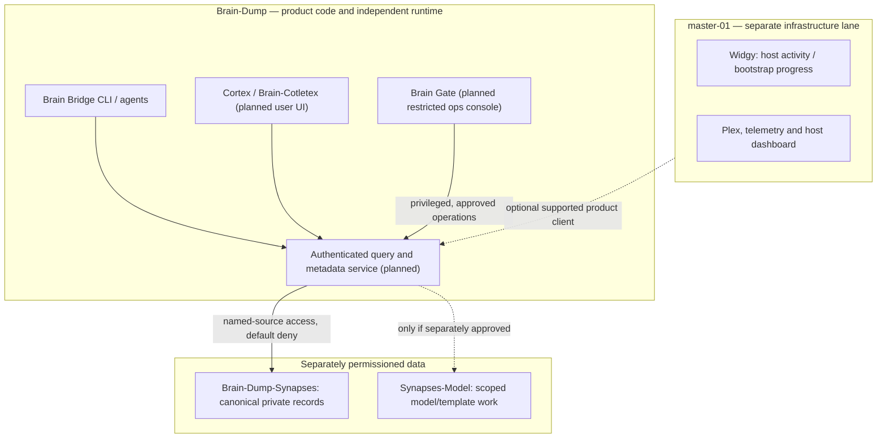
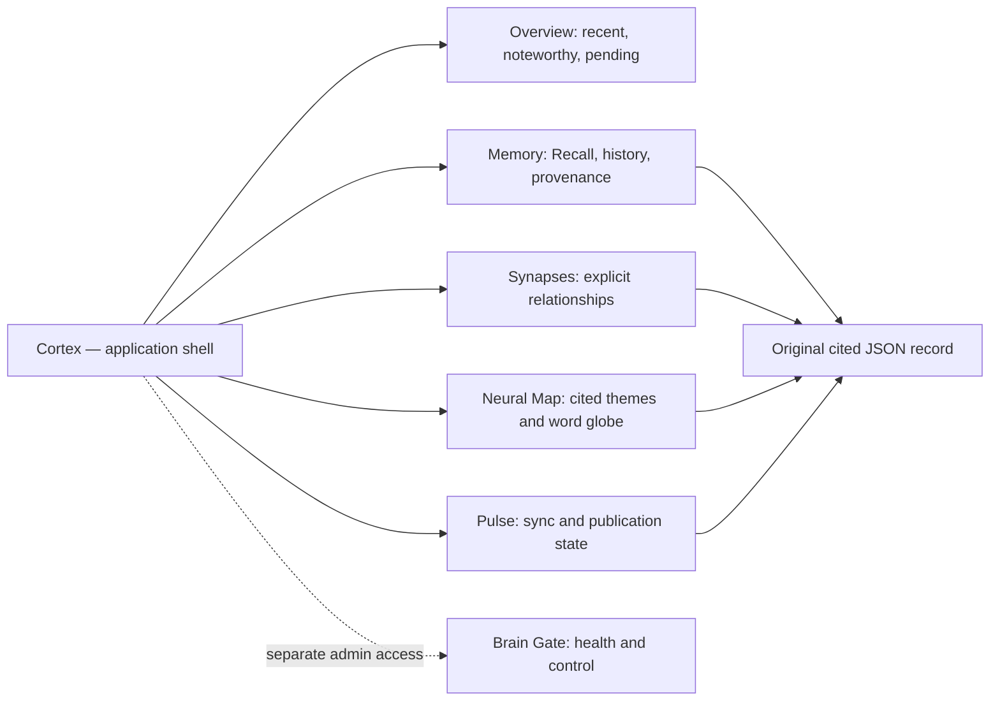
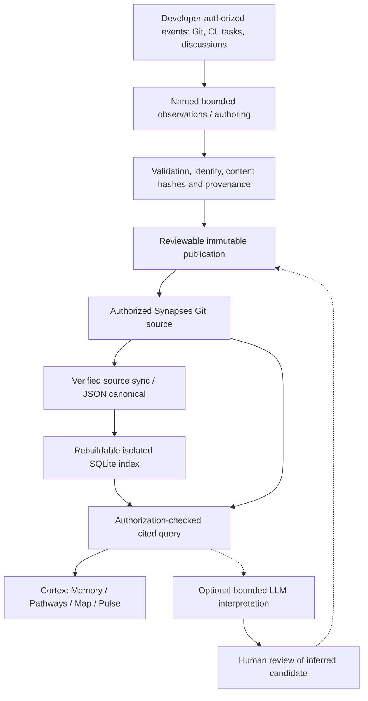

# Brain Evolution — From Recorded Context to Collaborative Intelligence

> **Vision and architectural direction — 7 November 2026.**
> This is a living product vision, terminology reference, design map, and staged roadmap. It complements—not replaces—the [BDT delivery roadmap](docs/roadmap/README.md), [existing architecture](docs/ARCHITECTURE.md), and authoritative Simple-Todos BD/BDT work records. It is **not a statement that proposed services, dashboards, organizational peering, or autonomous workflows are shipped**.
>
> Brain-Dump software is **AGPL-3.0-only**, copyright © 2026 Creative Software Development. See [LICENSE](LICENSE) and [NOTICE](NOTICE). Never copy private operational records, prompts, identities, secrets, or corporate metadata into this public repository.

## 1. The idea

**Brain-Dump should evolve from a portable, cited Git-backed memory framework into a developer-centric, permission-aware knowledge and collaboration platform.** A developer should be able to ask *what happened, why, what evidence supports it, what changed, what remains blocked, and who else is working on adjacent problems*—without manually reconstructing months of chats, issues, code reviews, deployments, and handoffs.

Our ambition is **extreme integration with backend metadata**: preserve and connect authoritative identities, immutable record provenance, commit hashes, workflow and task evidence, timestamps, source freshness, explicit relationships, supersession, and review states. The system should turn scattered operational history into **navigable, cited context**, not a machine-generated substitute for source truth.

The longer-term aspiration is *inter-group collaboration*: developers and teams using independently installed Brain-Dump instances may **opt in to discover and consult explicitly shared Synapses** across authorized organizational boundaries, cite findings, propose new connections, and contribute reviewed knowledge back to an appropriate source. We will design the contracts now and expand the collaboration model later. **No global sharing, cross-team peering, enterprise SSO/tenancy, or general agent execution authority is implied by the present framework.**

### What success feels like

A developer joining an unfamiliar project can recall relevant decisions and inspect source-backed evidence; compare changing designs; discover a related incident from another opted-in team; see uncertainty and freshness; and create a reviewable handoff without searching every chat, repository, and dashboard separately. A team lead can distinguish actual completed work from drafts, pending PRs, and not-yet-deployed changes. A platform operator can observe and recover the Brain runtime without confusing user-facing search with administrative control.

## 2. The swim lanes are permanent design constraints



| Repository or system | It owns | It must not silently inherit |
| --- | --- | --- |
| **Brain-Dump** | Reusable source-neutral engine, CLI, packages, auth adapters, service, proposed Cortex UI, Brain Gate, generic bootstrap, schemas, synthetic tests | master-01 internals, host scripts, private corporate data |
| **Brain-Dump-Synapses** | Permissioned canonical memory records, provenance and history | the web product/runtime, automatic grants or execution rights |
| **Brain-Dump-Synapses-Model** | Separately reviewed model/schema/template work and guarded lifecycle (scope to be finalized under BDT49) | unreviewed operational migration, public exposure of private records |
| **master-01** | Plex/utility services, telemetry, host dashboards, Widgy, its own deployments | framework code ownership, canonical Synapses state, Cortex implementation |
| **Simple-Todos** | Authoritative tasks, track and project identity, statuses, dependencies, approvals and evidence | Brain runtime or inferred completion from narrative |

A Brain-Dump clean install, test suite, browser UI and API **must not require cloning, running, importing or deploying master-01**. The master-01 host may be an optional *consumer*, never the architectural owner. Cross-repository sharing happens through explicit, versioned, authenticated product interfaces. Reusable UX ideas and open protocols are fine; accidental code ownership, duplicated collectors, and hidden bootstrap dependencies are not.

**Administrative task isolation:** existing BD/BDT work is currently tracked in Simple-Todos; its project/track ownership should be reconciled with a dedicated Brain-Dump project when the authoritative task system supports a safe UUID- and history-preserving migration. Do not manufacture new task IDs, duplicate TODOs, or move task JSON by hand.

## 3. Hybrid neural vocabulary — one meaning per term

Names are navigation and product metaphors, **not new sources of authority, new security principals, or descriptions of a model's private reasoning**. Stable machine identifiers should outlive display-name edits. **Cortex** is the preferred concise name; **Brain-Cotletex** remains an explicitly discussed product-label candidate, not a settled API or repository rename.

| Term | Stable conceptual ID | Role and boundary | Disposition |
| --- | --- | --- | --- |
| **Brain-Dump** | `brain-dump` | Entire independent software product | Existing |
| **Brain Bridge** | `brain-bridge` | Existing CLI/integration contract for agent consultation, evidence and publication | Existing; preserve |
| **Synapses** | `synapses` | Canonical permissioned memory repository and recorded link vocabulary; distinguish storage from graph edges | Existing; preserve |
| **Cortex / Brain-Cotletex** | `cortex` | Human-facing portal and navigation shell | Proposed; BDT30 |
| **Memory** | `memory` | Searchable historical record explorer | Proposed UI |
| **Recall** | `recall` | Cited, authorized retrieval action, reusing synapse consultation | Proposed UI action |
| **Encode** | `encode` | Prepare and validate an authored knowledge envelope before publication | Proposed workflow label |
| **Consolidate** | `consolidate` | Produce reviewable syntheses with links to original records, never rewrite originals | Future workflow |
| **Neural Pathways** | `pathways` | Explicit record/evidence/decision relationship explorer | Proposed visualization |
| **Neuroplasticity** | `evolution` | Superseded decisions and change-over-time display | Future UI filter |
| **Neural Map** | `neural-map` | Recorded topic/prevalence globe and graph exploration | Proposed; BDT31 |
| **Pulse** | `pulse` | Data freshness, sync, submission, observed events and status | Proposed; BDT32/35 |
| **Attention** | `attention` | Human review and exception queue, derived from real authority | Future |
| **Impulse** | `impulse` | Durable incoming event/request envelope, not a grant or command | Future |
| **Reflex** | `reflex` | Configured, approved event-driven action rules with explicit safety gates | Future |
| **Thalamus** | `routing` | Inspect registered sources and route policy; server still enforces grants | Proposed ops concept |
| **Brainstem** | `health` | Shared runtime-health diagnostics, not host telemetry ownership | Proposed ops concept |
| **Brain Gate** | `brain-gate` | Separate, tightly restricted Brain operations/maintenance console | Planned; BDT48 |
| **Dreaming** | `consolidation-jobs` | Optional offline, consented interpretation and proposed connections | Future; BDT33/34 |
| **Widgy** | `widgy` | OS-aware corner dashboard and structured bootstrap progress | Separate master-01 lane; WDGY1/2 |

**Avoid lexical collisions.** The existing `brain-bridge synapse` command has an established cited read contract; `brain-bridge graph` has deterministic relationship semantics. New browser labels should not silently change either. Avoid calling unapproved inference “memory,” task suggestions “Done,” or proposed collaborative connections “trusted.”

## 4. Cortex information architecture: user-facing knowledge



**Overview:** authorized recent knowledge, source freshness, pending review and entry points, never a blended dump of everybody's private material.

**Memory / Recall:** source-scoped search, excerpts, record detail, original timestamps, citations, historical versions, provenance and uncertainty. A missing match, empty corpus, denied permission, unavailable upstream, and index failure are different outcomes.

**Synapses / Neural Pathways:** view explicit `contains`, `covers_since`, `supersedes`, `evidenced_by`, `references`, and authoritative task dependencies. Broken references, unresolved tasks and cycles remain visible, never silently repaired by inference.

**Neural Map:** a transparent rotating thought-word globe showing **prevalence of recorded terms** in selected authorized content, with source/date filters, selection-to-record citations, pause/reduced-motion and accessible list fallback. It **does not display hidden model thoughts**. Aggregates can reveal private topics; authorization must cover every contributing record.

**Pulse:** show verified remote snapshot, local indexed commit, sync lag, pending PR receipts, errors, retries and actual publication state. An unmerged proposal is not canonical; a successful source test is not a production deployment.

**Brain Gate:** privileged administrative operations (health, configuration validation, repair, approved restart/rollback), with separate permissions, auditable action receipts and no arbitrary browser-originated shell instructions. **Brain Gate should not be renamed Cortex:** Cortex is the everyday *front door*; Gate is the distinct *control room*. Their styles may be related; privileges are not.

**Widgy** stays in the master-01 lane. It presents host activity and structured bootstrap progress, not organizational knowledge; it does not become the Brain dashboard by reuse or renaming.

## 5. Extreme backend metadata integration

The value is in the **links among verifiable facts**, not collecting more text without purpose. Preserve source attribution at the smallest useful unit and make each transformation traceable.

| Metadata plane | Canonical examples | UI / collaboration value | Trust constraint |
| --- | --- | --- | --- |
| Source identity | Named source, repository numeric ID, branch, verified commit, policy revision | “Which source and exact version did this answer use?” | Verify against authenticated registration |
| Record identity | Entry UUID, ledger path, raw SHA-256, schema version, timestamp, JSON Pointer | Stable, replayable citations | Immutable canonical bytes; historical compatibility by review |
| Provenance | Actor/repository/run references and separately hash-bound overlays | Why/how a fact entered the Brain | Evidence is observation, not instruction |
| Change relationships | Coverage anchors, supersedes, explicit evidence links | Decision evolution and cause chain | Never invent semantic certainty |
| Task/work evidence | Authoritative task UUID, project, revision, dependency, status, CI run or PR | Identify actual blockers and work in flight | No task completion inferred from prose |
| Delivery evidence | Tested head, merged commit, deployment attempt, accepted runtime version | Avoid conflating merged, deployed and accepted | Independent lifecycles and receipts |
| Access and freshness | Caller, granted source scope, policy freshness, cache/index commit | Safe, timely consultation across groups | Recheck authorization before disclosure |
| Interpretation | Selected input citation set, model, output, flags and review state | Candidate themes or connections | Mark as inferred, never silently publish as fact |



Existing components already offer useful building blocks: `brain_bridge/synapse.py`, `managed.py`, `store.py`, `graphs.py`, `authority.py`, `sync.py`, `reconciliation.py`, `publication.py`, `operator/`, `connectors.py`, `github.py` and `validation.py`. The [cited synapse interface](docs/SYNAPSE-CONSULT.md), [managed-source contract](docs/MANAGED-SOURCES.md), [evidence graph rules](docs/OBSERVABILITY.md) and [operator contract](docs/OPERATOR.md) are foundational, not browser endpoints. A shared query/status service, authenticated web UI and complete deployment experience remain roadmap work.

**Engineering principle:** a graph is a materialized view of explicitly evidenced relationships. Inferred topical similarity can be shown as a **separate untrusted suggestion layer**, never blended into the source-of-truth edges. Capture citation IDs, source revision and provenance on every rendered insight so developers can move from graphic to primary evidence.

## 6. Developer journey and group collaboration — future expansion

```mermaid
sequenceDiagram
  actor DevA as Developer A
  participant Cortex as Cortex
  participant Policy as Source authorization
  participant TeamA as Team A Synapses
  participant TeamB as Team B Synapses (opt-in)
  actor Review as Authorized reviewer
  DevA->>Cortex: Recall deployment decision
  Cortex->>Policy: Validate principal and named source
  Policy->>TeamA: Authorized immutable read
  TeamA-->>Cortex: Records, hashes, cited pointers
  Cortex-->>DevA: Verifiable source-scoped result
  DevA->>Cortex: Request cross-team related context
  Cortex->>Policy: Check explicit Team B sharing grant
  alt Team B source authorized
    Policy->>TeamB: Bounded read of approved scope
    TeamB-->>Cortex: Cited approved references
    Cortex-->>DevA: Related evidence with provenance
    DevA->>Review: Propose reviewed linked knowledge
    Review-->>DevA: Approval or rejection
  else Not authorized
    Policy-->>Cortex: Denied; no content or aggregates
    Cortex-->>DevA: Access not available
  end
```

### Collaboration model to design, not assume

1. Each developer or group retains an independently owned repository, identity, policy and canonical history. Installation alone does not enroll anybody into a shared Brain.
2. Source owners deliberately register **discoverable scopes** and explicitly grant readers; readers never gain writer or operator authority from a citation or search result.
3. An authorized developer can consult **only the approved scope**, compare contextual evidence with their own team's work, and navigate back to original sources.
4. A proposed cross-group connection records both evidence anchors and source revisions. The other group's records remain intact; contribution to either source follows its writer grant, review and immutable publication path.
5. Conflicting, stale or superseded information is disclosed as such. Humans resolve consequential disputes; agents can suggest investigation but cannot unilaterally resolve contradictions.
6. Group-wide topic counts, search previews, source existence and error messages can leak sensitive information; cross-group discovery requires a separately reviewed disclosure policy, including whether a source may be advertised at all.

**Future architecture questions (intentionally open):** groups and tenant identity; organizational policy hierarchy; SSO and role mapping; metadata-only discovery versus content access; source-owner consent; redaction and retention; auditable invitation/revocation; offline snapshots and revocation latency; cross-source rankings; conflicts and merge-review authority; secure sharing of analysis outputs; cost budgets; and interoperability with GitHub, GitLab, Jenkins and other approved providers. Design with test fixtures before piloting real corporate material.

### Illustrative, not yet implemented

A developer in Team A investigates a failed deployment. Cortex retrieves Team A's authorized decision history and linked CI evidence. If Team B has explicitly permitted sharing relevant records, a scoped Synapses query suggests an earlier matching failure, showing exact dated references and limitations. The developer creates a citation-backed proposal; the appropriate owner reviews and publishes it. Neither team grants unrestricted filesystem access, and neither team automatically inherits the other's private memories.

## 7. Safety, security and human authority

- **Default deny.** GitHub permissions remain the hard repository boundary for the current model; cooperative manifests are not a substitute for provider-level access control. Treat corporate SSO, multi-tenant enforcement and federation as work to be designed and verified, not shipped facts.
- **No hidden authority.** A Brain Dump, search hit, imported ticket, tool result or LLM recommendation is evidence/context, never a permission grant, instruction to execute, or status mutation.
- **Exact provenance.** Source ID, revision, entry ID, hash and pointer must accompany citations. When a source cannot be reverified, say so; do not present cached access as continuously authorized.
- **Privacy by construction.** No cross-source autocomplete, vocabulary globe, counts, graph adjacency or source-name leakage without verified visibility rights. Restrict raw content and redact secrets before publication.
- **Separate concerns.** Human search permissions are not writer grants; writer grants are not Brain Gate operator privileges. Publish, merge, deploy and accept are distinct states.
- **Opt-in interpretation.** A model can help identify possible patterns, but must label inference, preserve inputs/citations, bound resources, and require review before canonical write.
- **Resilience.** Interrupted sync, missing source, dirty checkout, corruption, lost permission, revoked access and offline mode must produce explicit status, not misleading success.
- **No host dependency.** The framework and UI do not use master-01 as a required collector, scheduler, proxy or application module.
- **Accessible alternatives.** All motion-based visualizations need keyboard support, accessible lists and reduced-motion handling.

## 8. Evolution roadmap — vision aligned to authoritative TODOs

This table describes **intent and dependencies**, not current task completion. The [BDT roadmap](docs/roadmap/README.md) defines detailed technical acceptance; **Simple-Todos is authoritative for status, UUIDs, dependencies and evidence**. Never replace those with this narrative.

| Horizon | Product outcome | Existing anchor | Exit criterion |
| --- | --- | --- | --- |
| **0 — Define the language and boundaries** | Approved terminology, data roles, Cortex vs Gate, no master-01 inheritance | BDT2/4/5/6; existing BD ownership work | Reviewed contracts, source identity and isolation tests |
| **1 — Trustworthy local Brain** | Direct authorized consultation, immutable history, isolated cache, incremental indexing and reliable sync | BDT8–18; existing Brain Bridge functionality | Repeatable cited queries; controlled freshness and recovery |
| **2 — Portable access** | Shared query/status service, local and remote MCP, independent bootstrap and supported clients | BDT16–29 (including BDT22 WIP at design time) | Clean installation without master-01; auth/transport acceptance |
| **3 — Cortex** | Authenticated Memory/Recall, Synapses explorer, metadata-linked views | BDT30 and BD8; possible dedicated CORTEX track pending canonical creation | Real browser, citations, source filters, error handling and mobile/a11y |
| **4 — Neural Map + Pulse** | Accessible word globe, provenance explorer, sync/submission visibility | BDT31/32; historical BD40 reference | Authorized aggregates, deterministic relations and accurate publication states |
| **5 — Brain Gate** | Privileged Brain service health and controlled operational actions | BDT48; BDT35/37 | Role isolation, audited operations, restart/restore evidence |
| **6 — Optional interpretation** | Reviewed suggestions, consolidation and cross-record inference | BDT33/34 | Opt-in bounded backend, citation binding, human review |
| **7 — Opt-in inter-group Synapses** | Source-scoped discovery, peering, contribution and collaborative insight | Future expansion of BD13/14/15 and BDT security/release gates | Approved tenancy and sharing contracts; demonstrable non-disclosure and revocation |
| **8 — Production readiness** | Security, benchmarks, backup, packaging, documentation, pilots and observation | BDT35–45, portability BDT46/47, model work BDT49 | Recorded independent acceptance and supported deployment scope |

A standalone **CORTEX** track is a sensible decomposition for detailed UI subfeatures, while BDT remains the cross-cutting delivery program. If/when Simple-Todos creates it, connect actual new UUIDs and dependencies rather than claiming this document creates tasks. Keep Brain Gate as BDT48, Widgy as WDGY1/2 in master-01, and existing BD/BDT historical IDs intact.

### Acceptance metrics to establish before promising a release

Set and measure: permission-denied disclosure tests; revocation latency; citation fidelity; graph edge provenance parity; correct distinction between proposed/merged/deployed/accepted; cache freshness and sync recovery; retrieval performance by mode; keyboard/mobile accessibility; install/upgrade/rollback reproducibility; absence of master-01 imports; and cross-group data-leakage adversarial tests. Benchmark numbers in the BDT roadmap are *proposals* pending approved fixtures and measured evidence.

## 9. Graphics as living architecture

The Mermaid figures above are **source-controlled, text-reviewable graphics**, not screenshots of running systems. Revise them along with terminology and contracts. The existing [BDT architecture SVG](docs/roadmap/architecture.svg) remains the implementation planning diagram; this document describes **product evolution and human experience**. Never imply a planned arrow in either diagram is proof of deployed integration.

A future user-facing visualization can combine:
- a **Synapses graph** with provenance-filtered edges and unresolved references;
- a **Neural Map** transparent rotating word globe with an accessible textual equivalent;
- a **Pulse** status and evidence timeline;
- a **collaboration boundary map** showing explicitly authorized team/source links without advertising private source existence.

## 10. Stewardship and next decisions

Treat this document as a living north-star narrative, updated through normal reviewed Brain-Dump PRs. Maintain a stable vocabulary registry and cross-links to BDT/CORTEX acceptance records. Separate **verified today**, **planned under an existing task**, and **future research** in every major revision. Require source-specific review before introducing real organizational sharing.

**Near-term decisions:** confirm Cortex versus Brain-Cotletex as the public display label; define a standalone CORTEX backlog and ownership migration in Simple-Todos; approve the metadata API and source-security boundaries; decide which Brain Gate functions are safe to expose; and establish collaboration governance without presuming any cross-group grant.

**Long-term promise:** every authorized developer can move from isolated chat history to **shared understanding grounded in evidence**—seeing the right Synapses, understanding why decisions changed, finding collaborators across explicitly consenting groups, and contributing improvements without surrendering data ownership, privacy, or approval control.

---

### Authoritative companion references

- [BDT roadmap and implementation gates](docs/roadmap/README.md)
- [Local-first architecture](docs/ARCHITECTURE.md)
- [Cited Synapses consultation contract](docs/SYNAPSE-CONSULT.md)
- [Managed-source trust boundary](docs/MANAGED-SOURCES.md)
- [Evidence graph contract](docs/OBSERVABILITY.md)
- [Operator publication and approval contract](docs/OPERATOR.md)
- [Brain-Dump agent policy](AGENTS.md)
- [Master-01 integration isolation and task context (historical)](https://github.com/asalaices/master-01)
- [Simple-Todos canonical backlog repository](https://github.com/asalaices/Simple-Todos)

> **Maintainer note:** This is public, conceptual documentation. It creates no grants, source registrations, task records, deployments or agent privileges, and contains no private Synapses payload.
