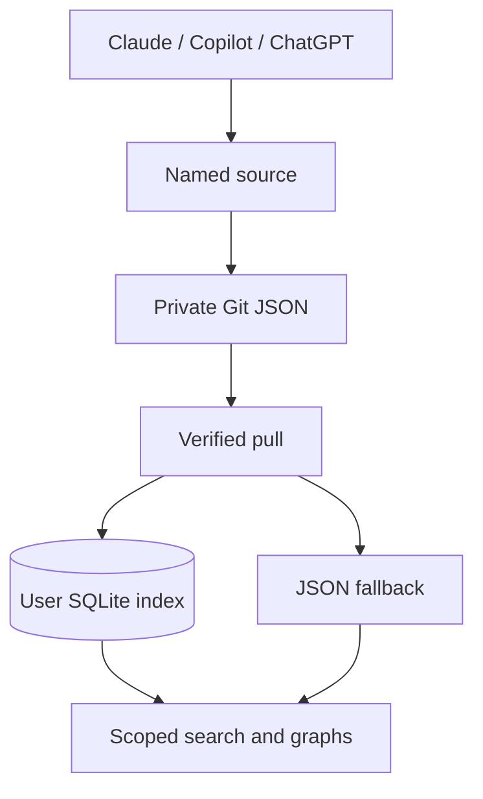

# Local-first architecture

Git JSON in separately permissioned repositories is canonical. Local SQLite is a rebuildable query index. Repository permissions control access. PR publication is default; an append-only direct default-branch publisher is future work and requires explicit named data-repository authorization. No production remote database required.
