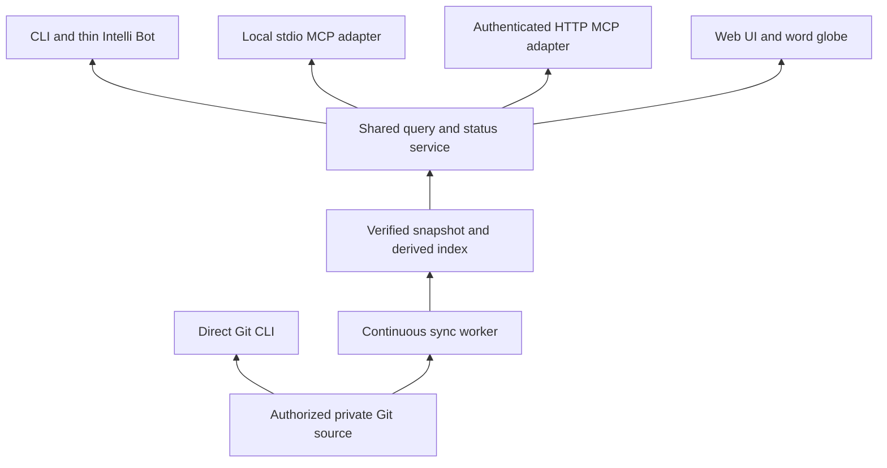

# Brain delivery, transports and web experience roadmap (BDT)

Planning baseline: **2026-11-06 (America/Chicago)**. This is an implementation
roadmap, not a claim that the service, bootstrap, MCP adapters or web UI already
exist. The authoritative execution statuses, internal UUIDs, evidence and
dependencies live in the owner's Simple-Todos **BDT** track. This public document
defines scope and task labels; it does not embed private tracker data.

## Product outcome and repository ownership

Install one Brain runtime that can read authorized remote Git history directly,
maintain a verified local cache continuously, and expose cited consultation to
local bots, supported assistant clients and a web UI. The same engine runs on a
personal computer or an always-on server. Continuous sync is deterministic
software; an LLM is optional for interpretation, not required to keep data current.

- **Brain-Dump:** reusable engine, CLI, service, bootstrap, MCP adapters, web UI,
  word globe, packaging, schemas and synthetic tests/examples.
- **Private data repositories:** immutable records, provenance and reviewed source
  access policy. Public software does not grant access to somebody else's Brain.
- **Instance storage:** credentials references, protected configuration, worker
  state, Git reader, derived indexes, logs and pending publication receipts.
  Indexes are rebuildable; unsubmitted drafts and uncertain publication receipts
  require durable preservation.
- **Project Intelli Bot:** a thin adapter to the public engine. Public installation
  must work without a private project checkout or bespoke shell wrappers.

Existing foundations include guarded managed sync, derived SQLite indexing,
authorized cited synapse reads and immutable PR-based publication. They are not
yet evidence of a continuous daemon, optimized search service, client matrix,
production web application or automated installation. Reuse and extend these
foundations; inventory exact gaps in BDT2.

## Five access modes

| Mode | Execution and data path | Persistent resources | Assistant connection |
| --- | --- | --- | --- |
| A: direct Git | Local bot/CLI authenticates remote source, obtains verified immutable Git snapshot and searches it | Runtime/config; Git objects may be temporary or retained; no persistent search index required | Local command-capable agent; no public listener or tunnel |
| B: managed local cache | Local bot/CLI queries verified local index while worker syncs remote Git | Protected reader, index, worker state and supervised service | Local command API; explicitly selected consistency policy |
| C: local MCP | Same local service/cache with MCP adapter | Mode B plus supported client registration | Client supporting local stdio MCP; no tunnel required |
| D: remote MCP | Always-on service/cache near its storage | Server runtime, authenticated HTTPS endpoint, optional tunnel | Compatible cloud or desktop client; local to server does not mean local to browser |
| E: web UI | Browser calls authorized service API | Same service/cache plus UI assets | Human search, cited records, sync view and optional word globe; copy/export fallback for unsupported clients |

Direct mode is still allowed to retain verified Git objects; it does not mean a
provider API request for each matching word. Cache mode moves indexing and sync
off the query path. Neither mode treats a cached permission as current authority.

## Client capability, not product-name assumptions

ChatGPT web, editor extensions, desktop applications and products called Copilot
can expose different tool connections. Maintain a tested matrix by exact product,
version/account constraints and available local-command, local-MCP or remote-MCP
support. A local MCP-capable client can use stdio; a cloud client needs a reachable,
authorized endpoint. The endpoint may run on a server rather than require every
user to expose a laptop. A tunnel is one deployment option, not a universal
dependency. Unsupported clients receive honest manual/cited-result instructions.

Protocol implementation must pin a supported version and test negotiation,
authorization and transport behavior. See the official
[MCP transport documentation](https://modelcontextprotocol.io/specification/2025-11-25/basic/transports).
This reference describes transport concepts; it is not a promise that every
named client supports that protocol version or integration.

## End-to-end bootstrap is a first-class deliverable

Provide **one public bootstrap entrypoint** with mode selection, plan/dry-run by
default and explicit execution. No command examples below imply an installer
already exists. The installer owns resource discovery, binary/runtime acquisition,
private config/cache/log paths, source/credential references, service supervision,
optional tunnel/DNS/TLS configuration, MCP client settings and final health checks.

The dependency graph determines install order. Independent downloads/checks may
run concurrently; configuration waits for required binaries, credentials and
service readiness. Resume uses an ownership journal, not blind reruns. Progress
supports ANSI by default and --no-ansi; --json/--pretty returns clean structured
plans/receipts instead of mixed terminal drawing. MCP stdout remains protocol-only.

Detect before changing. Preview exact client-config merges, preserve unrelated
settings and take protected backups. Reuse existing valid resources only after
identity/ownership checks. Do not silently obtain credentials, weaken TLS, replace
global binaries, seize ports, overwrite tunnels or register unsupported clients.
Provider-specific tunnel adapters and client-specific MCP settings are tested
extensions to the same installer, not separate untracked scripts.

Native installation and container deployment must share configuration/schema and
engine contracts. Container mode still needs explicit host/client registration;
it does not magically modify a remote browser's settings. Support transactional
upgrade, rollback, repair/status and owned-resource uninstall. Preserve records,
pending drafts and credential stores during removal.

## Sync, consistency and access contract

Worker: authenticate source and policy, inspect remote head, fetch only needed
changes into an owned reader, validate immutable records/provenance/hashes, update
the index transactionally, then publish a verified generation. Readers pin one
generation. Polling is authoritative; authenticated webhooks are optional wake-up
hints. Coalesce triggers and back off on provider limits. Never operate on or
reset an unrelated developer checkout.

Track four facts independently: remote head at last successful check, verified
data snapshot, indexed snapshot and current authorization. Responses carry source
identity, request ID, record/entry/pointer citation, hashes, commit, last remote
check, backend and stale/lag state. Status must not call old local data remotely
fresh just because its index matches its checkout. Wait-for-sync has bounded
timeouts/cancellation and reports actual progress; it never manufactures success.

Current managed reads refresh authorization upstream before cache access and
before disclosure. Preserve that strict default. Removing network checks from
every query requires an explicitly reviewed authorization lease contract with
principal/source/scope binding, expiry, clock handling and maximum revocation
delay. A remembered successful GitHub response is not a lease. If that policy
is not approved, ship strict mode and report its measured network cost. Neither
an outage nor stale cache permits a cached-allow fallback after authorization
fails. Do not advertise offline private access without a separately accepted policy.

Read sync cannot publish new records. Optional submissions use enrolled writer
authority and the existing draft/PR/canonical-receipt flow, with immutable IDs,
original bytes, durable pending state and idempotent retries. A pushed branch or
open PR is not a merged canonical synapse. No automatic grant or routing change.

## Web experience and interpretation

Start with cited search/history/provenance, access-aware records and explicit
freshness/errors. Add the transparent rotating word globe with documented word
frequency/prevalence, larger labels for common themes, source/time filters,
selection-to-record citations and reduced-motion/list alternatives. Aggregates
obey the same caller permissions as records; they can leak private topics too.
Describe it as a view of recorded themes, never hidden model reasoning.

Optional backend interpretation can analyze explicitly selected authorized
conversation/synapse extracts through MCP, including a user-operated Ollama
backend. Queue work, bound resources and label inference separately from cited
facts. Coordinate an existing backend-provisioning track rather than duplicate
it. Search/sync remain functional with no LLM installed. GitHub is the initial
source priority; email/AWS SNS and other provider expansion remain later work
under their own connector acceptance, not an assumed dependency of this runtime.

## Delivery and production gates

| Gate | Required outcome | Task range |
| --- | --- | --- |
| G0: agreed contract | Inventory, mode/support targets, threat model, query schema and access policy | BDT1–7 |
| G1: usable local engine | Direct Git bot plus verified cache/continuous sync/service with recovery | BDT8–18 |
| G2: installable access | Tested MCP adapters and end-to-end bootstrap, optional tunnel and client settings | BDT19–29 |
| G3: complete experience | Cited web UI, accessible word globe, operations view and accepted optional interpretation | BDT30–34 |
| G4: release evidence | Telemetry, benchmarks, restore/security, distributions, E2E and operator guides | BDT35–41 |
| G5: production | Live personal/server pilots, readiness review, release and observation | BDT42–45 |

Proposed benchmark starting points, **not accepted guarantees**: warm cached
keyword-query p95 <=100 ms on a specified reference machine with 100,000 synthetic
entries and 20 concurrent clients; 1,000-record catch-up <=60 seconds after fetch;
30-second nominal remote polling. Measure data-query time separately from strict
authorization/provider/network time and end-to-end user latency. BDT3 must approve
or revise these plus availability, detection delay, RPO/RTO and pilot duration.

Production acceptance requires clean-machine installs, source/caller isolation,
revocation/expiry tests, interruption/corruption/space-pressure recovery,
publication retry integrity, upgrade/rollback, backup/restore, client-specific
live evidence, performance against agreed fixtures and named operational owners.
Readiness applies per shipped feature and mode: optional unfinished features must
be disabled and documented, never counted as accepted. The full BDT scope stays
open until its remaining obligations are completed or explicitly rescaled.

No elapsed-time estimate is invented here; BDT2/3 establish engineering estimates
after the current code/client/installer inventory. Prioritize G0, then direct Git
and local cache in parallel where dependencies allow, then install/client access.
Web and interpretation can proceed after their actual prerequisites. A README,
passing unit tests or merged PR alone never means production deployment succeeded.

## Dependency-linked implementation backlog

Each item below maps to one task in the BDT track. Task status is maintained in
Simple-Todos, not copied here as a second editable checklist. Mark started work
WIP; close only after acceptance evidence is saved and a fresh authoritative query
returns Done. Do not close whole tracks because a subset of work is finished.

### BDT1: Publish the BDT architecture and production roadmap

Phase: Foundation. Prerequisites: None.

Acceptance: Roadmap covers all access modes, repository boundaries, bootstrap ownership, dependency-linked delivery steps, production gates and truthful current status; linked from the main README and reconciled with authoritative BDT tasks.

### BDT2: Inventory existing runtime contracts and map BD overlap

Phase: Foundation. Prerequisites: BDT1.

Acceptance: Document reusable sync/index/consult/publication modules and gaps against current code. Map existing BD tasks by UUID without duplicating or closing their unfinished acceptance; assign component ownership and version boundaries.

### BDT3: Approve measurable service and support targets

Phase: Foundation. Prerequisites: BDT2.

Acceptance: Record supported operating systems, client versions, corpus fixtures, concurrency, latency, sync lag, availability, RPO/RTO and support policy. Treat roadmap example targets as proposals until benchmarked and accepted.

### BDT4: Define source identity, credential and deployment threat model

Phase: Foundation. Prerequisites: BDT2.

Acceptance: Review personal and shared-server trust boundaries, caller-to-source authorization, cache ownership, remote endpoint exposure, prompt injection, secret handling, transport threats and isolation tests. Separate software license from private data rights.

### BDT5: Specify versioned query, status and publication contracts

Phase: Foundation. Prerequisites: BDT2, BDT4.

Acceptance: Publish schemas for cited results, pagination, errors, health, freshness, sync operations and PR publication receipts; distinguish remote data head, verified snapshot, indexed commit and authorization freshness. Libraries, CLI and MCP share business semantics.

### BDT6: Preserve strict authorization across all adapters

Phase: Authorization. Prerequisites: BDT4, BDT5.

Acceptance: Local and remote queries cannot bypass managed source policy. Check caller identity and source grants, deny unavailable authorization, recheck before disclosure and test revocation/races; cache or local checkout possession is never a grant.

### BDT7: Design and review optional authorization leases

Phase: Authorization. Prerequisites: BDT3, BDT4, BDT6.

Acceptance: Document issuer/trust mechanism, principal/source/scope binding, maximum expiry, clock handling, restart behavior and bounded revocation delay. Strict mode remains default; do not enable leases merely from a cached successful GitHub response. Ship disabled if policy is unapproved.

### BDT8: Deliver a supported direct Git consultation mode

Phase: Direct Git. Prerequisites: BDT5, BDT6.

Acceptance: One-shot CLI authenticates named source, obtains/verifies immutable Git snapshot, searches without a persistent search database and returns citations/freshness/errors. Document temporary or retained Git objects, network cost and lack of offline authority; do not require users to expose a local port.

### BDT9: Publish a thin local Intelli Bot adapter

Phase: Direct Git. Prerequisites: BDT8.

Acceptance: Project Intelli Bot delegates to the public framework API/CLI, respects shared script/version/logging contracts, supports --json/--pretty and emits clean JSON errors. No duplicate query engine, embedded source grants or dependence on private master-01 for public users.

### BDT10: Implement isolated cache layout and schema migrations

Phase: Cache. Prerequisites: BDT5, BDT6.

Acceptance: Namespace cache by principal, source numeric identity and policy revision; keep index/state outside Git. Validate permissions, symlinks, schema migration and recovery; never mix two users or sources, and preserve old schema for rollback where needed.

### BDT11: Provide incremental indexed search with stable citations

Phase: Cache. Prerequisites: BDT10.

Acceptance: Index changed documents transactionally, verify hashes and duplicate IDs, preserve historical bytes and provenance, and offer indexed text search with stable pagination/ranking. Every excerpt maps to source commit, entry ID, record hash and JSON Pointer.

### BDT12: Build the continuously running deterministic sync worker

Phase: Sync. Prerequisites: BDT10, BDT11.

Acceptance: Worker uses its own managed reader, starts with authorized baseline, serializes writers and detects remote commit changes without a fetch for every query. Never reset, stash or alter a user working copy; startup/shutdown/restart are owned and observable.

### BDT13: Add polling, scheduling and optional webhook triggers

Phase: Sync. Prerequisites: BDT12.

Acceptance: Configurable polling with jitter, rate-limit/backoff handling and coalesced triggers; optional authenticated replay-resistant webhook only schedules authoritative verification. Missed events and sleep/resume recover through polling; webhook/tunnel are optional.

### BDT14: Publish cache generations atomically for concurrent readers

Phase: Sync. Prerequisites: BDT11, BDT12.

Acceptance: Queries pin one verified generation while worker builds the next. Crash, cancellation or corrupt batch cannot expose partial data; concurrency and transaction tests prove readers and sync do not corrupt or deadlock the index.

### BDT15: Handle remote divergence, outages and damaged local state

Phase: Sync. Prerequisites: BDT12, BDT13, BDT14.

Acceptance: Test timeout, rate limit, revoked credentials, disk-full, process kill, corruption, dirty reader, changed origin, rewritten remote history and source deletion. Preserve last good data, clearly label stale status and withhold reads when policy requires; no silent force-sync.

### BDT16: Expose a shared query and status service

Phase: Query service. Prerequisites: BDT5, BDT6, BDT14.

Acceptance: Local IPC or authenticated loopback service delegates to one query engine, validates bounded requests, applies caller-to-source policy, supports cancellation and has versioned health/status. No arbitrary shell/path execution or unauthenticated non-loopback listener.

### BDT17: Add configurable consistency and wait-for-sync behavior

Phase: Query service. Prerequisites: BDT7, BDT15, BDT16.

Acceptance: Explicit consistency modes distinguish cached snapshot from fresh remote verification. Bounded wait-for-sync returns an operation/status ID or structured timeout rather than false success; no stale permission fallback. Proposed leases require explicit enabled policy.

### BDT18: Integrate submission queue with existing PR-only publication

Phase: Publication. Prerequisites: BDT5, BDT6, BDT16.

Acceptance: Separate read sync from optional write enrollment. Preserve original draft bytes/ID across retries, show pending/pushed/PR-open/merged/canonical-verified states, and reconcile uncertain outcomes before retry. No autonomous main writes or auto-merge from sync.

### BDT19: Implement local stdio MCP adapter

Phase: Adapters. Prerequisites: BDT16, BDT17.

Acceptance: Expose bounded consult/get/status/sync tools using negotiated supported MCP protocol. Stdout contains only protocol frames; diagnostics use stderr/protected logs. Multiple clients use shared service without starting competing workers; local stdio needs no tunnel.

### BDT20: Implement authenticated remote HTTP MCP adapter

Phase: Adapters. Prerequisites: BDT4, BDT6, BDT16, BDT17.

Acceptance: Support a pinned tested MCP HTTP transport/version with applicable authorization, TLS, audience/scopes, origin/host checks, input limits and session lifecycle. Bind each caller to permitted sources; remote clients never inherit service-wide grants automatically.

### BDT21: Verify client capability and compatibility matrix

Phase: Adapters. Prerequisites: BDT19, BDT20.

Acceptance: Test named versions of ChatGPT web, applicable desktop apps, GitHub Copilot editor integrations, Copilot apps and CLI agents where supported. Record local-command/local-MCP/remote-MCP capability, setup, evidence and unsupported cases; never assume all products named Copilot share capabilities.

### BDT22: Build one plan-first public bootstrap entrypoint

Phase: Bootstrap. Prerequisites: BDT3, BDT4, BDT5.

Acceptance: Detect platform, supported interpreter/binaries, ports, existing resources and selected access mode. Produce reviewable machine-readable plan with dry-run default, explicit execution, idempotency, noninteractive behavior and safe dependency ordering; install no unnecessary tunnel or service for direct mode.

### BDT23: Acquire and verify binaries and isolated runtime

Phase: Bootstrap. Prerequisites: BDT22.

Acceptance: Pin supported package/runtime versions and verify trusted provenance/checksums/signatures as applicable. Handle architecture/platform and dependency conflicts; isolate environment, preserve existing binaries and avoid unreviewed curl-pipe-shell or global replacement.

### BDT24: Configure private storage and credential references

Phase: Bootstrap. Prerequisites: BDT4, BDT10, BDT22, BDT23.

Acceptance: Create protected config/state/cache/log paths and named source profiles; use existing credential providers or explicit enrollment flow without putting secrets in Git, plans, process arguments or logs. Validate source identity and least privilege, and preserve unrelated configuration.

### BDT25: Install and supervise local resources

Phase: Bootstrap. Prerequisites: BDT12, BDT16, BDT23, BDT24.

Acceptance: Configure one owned service through supported platform supervisor, startup ordering, process ownership, lock handling, restart/backoff and sleep/resume. Validate actual binaries, service health and cache access; cleanup never kills an unrelated process or deletes records.

### BDT26: Configure optional tunnel, DNS and TLS lifecycle

Phase: Bootstrap. Prerequisites: BDT20, BDT22, BDT24, BDT25.

Acceptance: Provider adapter previews selected endpoint, DNS/TLS and credential references, checks ownership, configures requested tunnel and verifies reachability/auth. Preserve existing tunnels/routes, handle renewal/reconnect and removal. No tunnel in local-only mode; direct server HTTPS is an alternative.

### BDT27: Configure MCP clients without clobbering settings

Phase: Bootstrap. Prerequisites: BDT19, BDT20, BDT21, BDT24, BDT25.

Acceptance: Discover only supported client configuration locations, preview exact per-client merge, back up existing settings and preserve unrelated servers. Configure stdio or remote endpoint as selected; unsupported managed clients get accurate manual instructions rather than fabricated local settings.

### BDT28: Implement transactional upgrades, rollback and uninstall

Phase: Bootstrap. Prerequisites: BDT23, BDT24, BDT25, BDT26, BDT27.

Acceptance: Journal owned resources, stage upgrade, run health checks and switch atomically where supported. Inject failure at each step and prove recovery. Rollback restores settings/runtime; uninstall removes only owned resources and preserves user records/credentials unless separately authorized.

### BDT29: Verify clean-machine installation across supported modes

Phase: Bootstrap. Prerequisites: BDT8, BDT9, BDT17, BDT21, BDT28.

Acceptance: On each supported platform exercise direct Git, local cache, local MCP and server/remote MCP variants, including no-admin/offline dependency failure, port collision, missing credentials and interrupted install. Fresh user can install, query cited synthetic record, sync, upgrade, roll back and uninstall from documented steps.

### BDT30: Deliver authenticated Brain browser and search UI

Phase: Web. Prerequisites: BDT16, BDT17, BDT20.

Acceptance: UI displays cited records, excerpts, history/provenance and explicit data/auth freshness; search and empty/error states work. Protect API mutations, authorization and browser rendering against injection and cross-origin misuse; no browser Git credentials or unrestricted raw cache access.

### BDT31: Build accessible transparent rotating word globe

Phase: Web. Prerequisites: BDT11, BDT30.

Acceptance: Define prevalence metric/tokenization/stop words and source/time filters; compute aggregates only from caller-authorized records. Show larger words for prevalence, transparent rotating globe, selection-to-cited-records, pause/reduced-motion and accessible list fallback; label as recorded themes, not private model thoughts.

### BDT32: Add operational sync and submission views

Phase: Web. Prerequisites: BDT15, BDT18, BDT30.

Acceptance: Show remote/index/verified commits, backlog, last checks, authorization expiry, retries and pending PR receipts. Explicit sync/submission actions report actual completion and limits without claiming unmerged data is canonical; sensitive diagnostics remain restricted.

### BDT33: Specify optional backend LLM interpretation contract

Phase: Interpretation. Prerequisites: BDT4, BDT5, BDT16.

Acceptance: Define explicit opt-in analysis of selected authorized synapse extracts/conversations, model endpoint, retention, redaction, token/resource budget and prompt-injection boundary. Separate recorded facts, citations and inferred tracks/focus; no automatic TODO completion or grant changes.

### BDT34: Implement queued backend interpretation via MCP

Phase: Interpretation. Prerequisites: BDT19, BDT20, BDT33.

Acceptance: Run selected backend such as Ollama through bounded authenticated adapter, support queue/cancel/timeouts and model-unavailable errors, preserve input citations and label output as inference. Core sync/search works without an LLM; coordinate existing MCP Ollama track ownership instead of duplicating provisioning.

### BDT35: Implement structured telemetry and protected audit trail

Phase: Operations. Prerequisites: BDT5, BDT12, BDT16, BDT18.

Acceptance: Emit versioned JSON errors/status and redacted logs for sync/query/bootstrap/publication with correlation IDs, timings and rotation/retention. CLI has --json/--pretty; human progress supports default --ansi and --no-ansi where applicable; MCP stdout stays framed. Document optional Git-backed telemetry policy without committing secrets or raw private excerpts by default.

### BDT36: Benchmark latency, scale, concurrency and sync cost

Phase: Operations. Prerequisites: BDT3, BDT11, BDT14, BDT17, BDT35.

Acceptance: Measure cold/warm direct and cached modes, authorization/network contribution, sync catch-up, globe aggregation, CPU/RAM/disk and concurrency on versioned synthetic fixtures. Publish methodology/results against accepted targets and gate regressions; no unmeasured millisecond claims.

### BDT37: Implement backup, restore and rebuild runbooks

Phase: Operations. Prerequisites: BDT10, BDT15, BDT18, BDT28.

Acceptance: Distinguish authoritative Git records from disposable indexes and durable pending drafts/receipts/config. Test restore and full cache rebuild, missing/corrupt backups, key references and retention against approved RPO/RTO; backup access cannot widen source audience.

### BDT38: Complete adversarial and privacy acceptance

Phase: Security. Prerequisites: BDT4, BDT6, BDT7, BDT15, BDT18, BDT20, BDT26, BDT30, BDT34.

Acceptance: Test cross-user/source leaks, grant revocation, lease expiry, clock skew, prompt injection, malicious JSON/HTML, auth/session misuse, tunnel exposure, credential rotation and denial of service. Resolve release-blocking findings and retain reproducible evidence with private findings kept private.

### BDT39: Publish reproducible container and native distributions

Phase: Packaging. Prerequisites: BDT23, BDT25, BDT28, BDT35.

Acceptance: Build versioned minimal non-root container with explicit persistent volumes, health checks, graceful shutdown and secrets outside image; native package/bootstrap uses same engine. Produce dependency/license inventory, checksums/provenance and compatibility/upgrade documentation with synthetic examples only.

### BDT40: Build end-to-end acceptance and fault-injection suites

Phase: Quality. Prerequisites: BDT8, BDT9, BDT17, BDT18, BDT19, BDT20, BDT28, BDT30, BDT31, BDT34, BDT37, BDT39.

Acceptance: Exercise each supported installation/client mode, consistency/citation integrity, publication retry, upgrade/rollback and restart using synthetic isolated fixtures. Cover outage/revocation/corruption and repeated install; distinguish offline regression from actual live acceptance.

### BDT41: Publish public onboarding, operator and client guides

Phase: Documentation. Prerequisites: BDT21, BDT29, BDT32, BDT35, BDT37, BDT39.

Acceptance: Provide mode selector, complete bootstrap examples, capabilities/limits, source registration, troubleshooting, tunnel/MCP settings, upgrades, recovery, attribution/license and support/reporting paths. Readers can follow clean-machine steps without private repo names, local owner paths or secrets.

### BDT42: Run bounded personal and always-on server pilots

Phase: Pilot. Prerequisites: BDT29, BDT32, BDT36, BDT38, BDT40, BDT41.

Acceptance: Operate both personal cache and server installations with approved test users/sources for the accepted observation window. Verify local and remote clients, actual sync latency, new-record visibility, permission revocation, tunnel recovery and rollback without changing existing production routing implicitly.

### BDT43: Review operational ownership and release readiness

Phase: Production. Prerequisites: BDT3, BDT36, BDT37, BDT38, BDT39, BDT40, BDT41, BDT42.

Acceptance: Assign support/security/incident and upgrade owners; review all release evidence, unresolved risks, compatibility matrix and operational budgets. Every shipped optional feature has acceptance or is disabled/documented; hosted CI limits do not waive local checks or normal repository protections.

### BDT44: Release and verify production deployment

Phase: Production. Prerequisites: BDT43.

Acceptance: Publish approved tagged artifacts/release notes, execute selected production rollout with health/citation/sync checks and a tested rollback window, and retain exact versions/receipts. Mark Done only after actual production acceptance, never from a plan, package build or merged PR alone.

### BDT45: Complete post-release observation and close accepted scope

Phase: Production. Prerequisites: BDT44.

Acceptance: Observe accepted reliability window, restore/revocation drills and user onboarding; resolve incidents and publish support handoff. Requery all completed BDT TODOs as Done with evidence; keep unsupported clients, deferred optional features and existing BD work explicitly pending rather than falsely closing the track.

